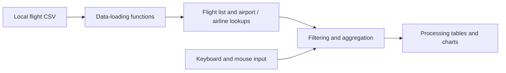

# Programming Project — Flight Data Visualisation

A **Processing (Java mode)** desktop application built as a team project for CSU11013. Its objective is to make a supplied flight dataset easier to explore through airport and date filters, paginated tables, airline comparisons and charts of flight outcomes and delays.

The application loads local CSV files; it does not connect to a live flight API or use a database server.

## My role and contributions

I developed the project's **data-loading and supporting data-model layer**:

- Read the flight file, skipped the header and populated `Flight` objects with route, schedule, outcome and distance fields.
- Built an airport lookup containing unique origin and destination airports.
- Wrote the `Flight` and `Airport` data classes.
- Implemented date/time formatting helpers and the original delay calculation, including overnight adjustment and non-negative delay handling.

The data-loading section is marked `// DANIEL` in [MyFlights.pde](MyFlights/MyFlights.pde). These responsibilities are my contribution to a shared application; teammates contributed the visual interface, charts and other features. The current integrated code includes later changes to some of these functions.

## System architecture



- [MyFlights.pde](MyFlights/MyFlights.pde) contains startup/rendering, navigation, loading, models and analysis functions. Data is held in `ArrayList` and `HashMap` collections.
- [Plane.pde](MyFlights/Plane.pde) supplies the animated plane. **Minim** plays the bundled audio.
- `setup()` loads **flights10k.csv** by default. Smaller `flights2k.csv` and larger `flights100k.csv` samples are also included.

## How to run

1. Install [Processing](https://processing.org/) and select **Java mode**.
2. Install the [Minim audio library](https://code.compartmental.net/tools/minim/) through Processing's library manager.
3. Clone the project and open `MyFlights/MyFlights.pde` in Processing. Keep `Plane.pde` in the same sketch folder.

```bash
git clone https://github.com/Npola1/Programming-Project.git
```

4. Use **Sketch → Add File** to add these bundled files to the sketch's `data/` folder: `flights10k.csv`, `Song.mp3`, `background.png`, `Background2.png`, `metalBird.png` and `elmoboom.png`. They are supplied in `MyFlights/`.
5. Press **Run**. The sketch opens a **1600 × 800** window; use the menu to select a view and the on-screen controls to filter or compare records.

To change the dataset, edit `loadFlightData("flights10k.csv")` in `setup()` and add the corresponding bundled CSV to `data/`.

## Current limitations

This is a coursework prototype. The airport-comparison interface is unfinished. The current loader splits rows on commas and does not handle quoted CSV fields; bundled city names contain commas, so some columns can be misread. Date filtering compares raw strings, and the integrated delay function uses `/ 60` and `% 60` on HHMM values instead of `/ 100` and `% 100`. These issues need correction before treating the displayed analysis as accurate.

The sketch entry point, library import and required assets were checked against the source. Interactive execution in Processing was not performed during this documentation update. Original team history is preserved from [YusufGunaydin1/P.PROJECT_FLIGHTS_NAH_GROUP](https://github.com/YusufGunaydin1/P.PROJECT_FLIGHTS_NAH_GROUP).
